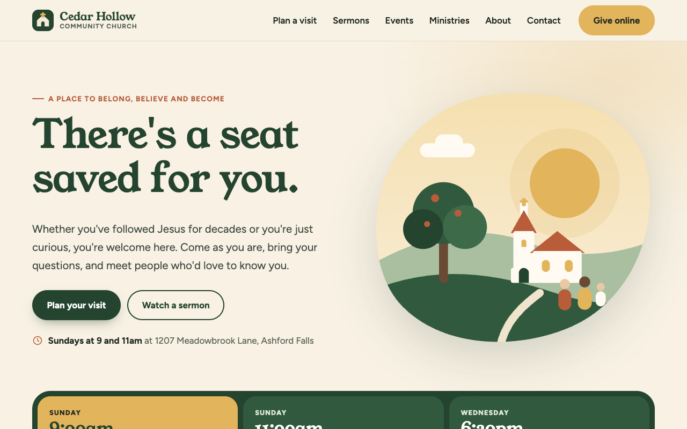

# Cedar Hollow: church website template

A warm, welcoming church website template with service times, a plan-your-visit guide, sermons that load only when played, an events calendar, ministries, staff, online giving and a contact and prayer request form. Built with Astro as a fully static site.



[](https://console.cloudzyro.com/new?repo=https://github.com/Cloudzyro/template-church)

## What's included

- Home page with service times, a welcome, what to expect, the latest sermon, upcoming events, ministries and a giving section
- Plan your visit page: service times, address and maps link, a step-by-step first Sunday (arrival, the service, kids, parking and accessibility) and an FAQ
- Sermons page built from a data file (title, speaker, date, series, scripture, summary) with click-to-load YouTube video (privacy-enhanced youtube-nocookie) or audio; nothing from YouTube or your audio host loads until someone presses play
- Events calendar grouped by month, with sign-up links; past events hide themselves automatically
- Ministries page and an About page with staff cards and illustrated initials avatars
- Give button that goes to any online giving page you choose
- Contact and prayer request form that works without a server, with a "keep this private" option for prayer requests (link to `/contact/?type=prayer` to open it on prayer)
- Church structured data, Open Graph tags, sitemap, robots.txt and favicon
- Responsive down to 360px, keyboard friendly, visible focus styles and reduced motion respected
- No tracking and no third-party scripts

## Run it locally

You need Node 22.23 or newer and pnpm.

```bash
pnpm install
pnpm dev       # http://localhost:4321
pnpm build     # static site in dist/
pnpm preview   # serve the build
```

## Make it yours

- **Content:** everything lives in `src/data/site.ts`: church name, address, phone, service times, the welcome text, what to expect, FAQ, sermons, events, ministries, staff and giving text.
- **Sermons:** add a sermon to the top of the `sermons` list. Set `youtubeId` to the 11-character ID from the video's link (`youtube.com/watch?v=ID`), or `audioUrl` to an MP3 or podcast episode file, or both. The samples use placeholder IDs, so pressing Watch shows a short note until you add real ones.
- **Events:** add events with a `YYYY-MM-DD` date. They're sorted and grouped by month for you, and anything in the past is hidden in the visitor's browser.
- **Giving:** set `giveUrl` in `src/data/site.ts` to your giving page (Tithe.ly, Pushpay, Planning Center Giving, PayPal or similar).
- **Contact and prayer form:** set `PUBLIC_FORM_ENDPOINT` to a form service address (Formspree, Basin, a Supabase function or similar). The form posts its fields there, including `request_type` and `keep_private`. With no endpoint set, the form shows a short note and opens the visitor's email app addressed to your `email`.
- **Site address:** set `SITE_URL` (for example `https://www.yourchurch.org`) so the sitemap, canonical links and social previews use it.
- **Colors and fonts:** the variables at the top of `src/styles/global.css`. Fonts are Young Serif and Figtree, self-hosted through Fontsource; swap the packages and the `--font-*` variables to change them.
- **Pictures:** the illustrations are SVG in `src/components/HeroArt.astro` and the staff avatars are drawn from initials in `src/pages/about.astro`. Put your photos in `src/assets/` and use Astro's `<Image>` component in their place.
- **Social preview image:** replace `public/og.png` (1200 x 630).

Copy `.env.example` to `.env` to set the variables locally. On Cloudzyro, add them in your site's environment settings.

## Deploy

Click the button above to make your own copy and put it online, or push your copy to GitHub and connect the repository in the Cloudzyro console. It builds with `pnpm build` and serves the static `dist/` folder.

## Stack

- [Astro](https://astro.build) 7, static output
- `@astrojs/sitemap`
- Young Serif and Figtree via Fontsource
- Plain CSS, a few lines of TypeScript for the menu, the players, the events list and the form

## License

MIT, see [LICENSE](./LICENSE).
